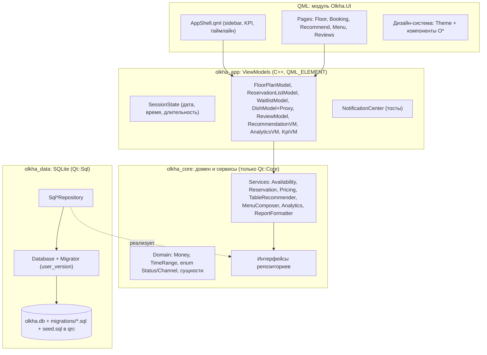
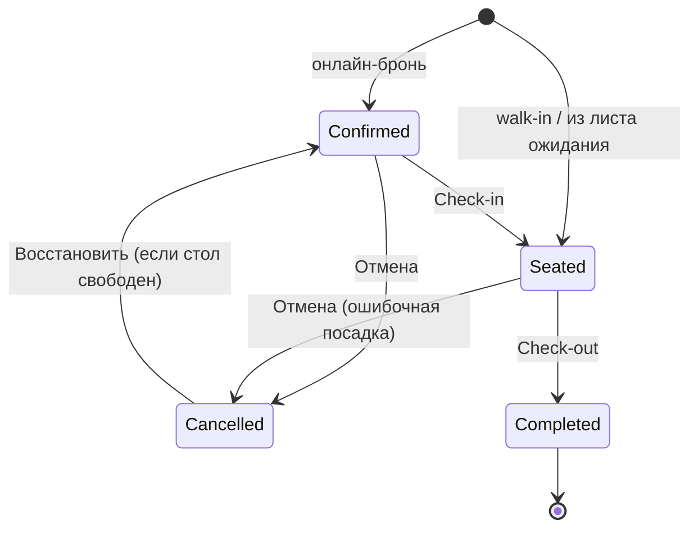

# План рефакторинга: «Ольха» — система бронирования (Qt 6 / QML / SQLite)

## Цель

Перевести учебный проект `restaurant_booking_qt` (бренд «Aura Gastronomy», Qt Widgets, всё в двух God-классах) на современную многослойную архитектуру. Новый интерфейс на Qt Quick (QML) — адаптивный, с собственной дизайн-системой и новым брендом **«Ольха»**. Функциональность сохраняется 1:1. Исключение одно, согласованное: шаг времени брони становится 30 минут вместо целого часа.

### Согласованные решения (по итогам интервью)

| # | Решение |
|---|---|
| 1 | UI: **Qt Quick / QML** + C++ бэкенд |
| 2 | **Qt ≥ 6.5**, разработка на Qt 6.8 LTS, поддержка Qt 5 и qmake удаляется |
| 3 | Локальная сборка: **Qt 6.8 + MinGW через aqtinstall**, CI на GitHub как вторая проверка |
| 4 | Функции сохраняются 1:1, улучшаются только UX и архитектура |
| 5 | Своя дизайн-система на стиле Basic, тёмная и светлая темы |
| 6 | Бренд **«Ольха»**: графит + тёплый беж, акцент «ольховое дерево» `#C8693A`, приглушённые статусы |
| 7 | Десктоп от 1024×640 до 4K с HiDPI, 3 точки перелома, боковое меню сворачивается |
| 8 | **Схема БД проектируется заново**, старая база не нужна |
| 9 | Время хранится с точностью до минут, шаг в UI 30 минут (настраивается) |
| 10 | **Qt Test + Qt Quick Test + CTest**, тесты запускаются в CI |
| 11 | Работа в копии `scratch\olkha-booking` с git, по коммиту на этап |
| 12 | Распространение — портативный ZIP (`windeployqt`), статическая сборка и `.bat` удаляются |

---

## Что не так сейчас (результаты анализа кода)

> [!WARNING]
> **Исходный проект не собирается.** `AnalyticsChartWidget.hpp/.cpp` есть в CMake, `.pro` и `MainWindow`, но самих файлов нет. Базовый коммит фиксирует оригинал «как есть».

**Архитектура**
- `MainWindow.cpp` на 1684 строки: вёрстка, обработчики, состояние экрана и две QSS-темы в одном классе.
- `DatabaseManager.cpp` на 1187 строк: подключение, схема, сид-данные, CRUD, бизнес-правила, рекомендации, аналитика и форматирование чеков.
- Маппинг строки БД в структуру скопирован: `TableInfo` — 2 раза, `ReservationInfo` — 3 раза (см. `getReservationsByDate`, `getAllReservations`, `getReservationById`).
- Статусы и типы брони — «магические» строки (`"Seated"`, `"WalkIn"`). Рекомендатель определяет VIP-зону через `zone.contains("VIP")`.
- Деньги хранятся в `double`, итог считается умножением на `0.95`.

**Производительность** — `refreshFloorMapAndCard()` на каждое изменение слайдера:
```
12 столов × (1 запрос занятости + 1 запрос рейтинга + до 13 запросов getFreeHoursFrom)
+ 13 запросов почасовой шкалы + N+1 запросов предзаказов + getTableById на каждую бронь
≈ 200+ SQL-запросов, после чего refreshAllViews() перерисовывает ВСЕ 5 экранов
```
В аналитике `getHourlyOccupiedTablesCount` даёт ещё 13 × 12 = 156 запросов.

**Корректность**
- Выручка в KPI считается как `max(предзаказ, депозит)`, а в `getRevenueByZone` — с запасным «45 BYN × гостей». Одна и та же метрика даёт разные числа.
- Код брони берётся как `MAX(id)+1`, а не генерируется базой.
- Удаление блюда каскадно стирает его из исторических предзаказов. Цена предзаказа не фиксируется на момент заказа.
- Проверка переходов статусов неполная: например, `Seated → Confirmed` разрешён.
- Ошибки SQL почти везде игнорируются (`q.exec(...)` без проверки).
- Дата `2026-10-16` зашита в UI и в `TablePreference`.

---

## Целевая архитектура



**Принципы:**
- Зависимости идут только сверху вниз. `olkha_core` ничего не знает о SQL и QML и тестируется без базы, на фейковых репозиториях.
- **Расписание дня в памяти (`DaySchedule`).** Все активные брони за дату загружаются одним запросом. Занятость, свободные окна, полоса таймлайна, KPI и почасовая загрузка считаются в памяти за O(брони × столы). Вместо 200+ запросов на одно действие — 1–3.
- **Точечная инвалидация.** Репозитории сообщают об изменении данных (`reservationsChanged(date)` и т.п.). Обновляются только затронутые модели, перерисовка всего приложения не нужна. Изменения слайдера проходят через debounce в 60 мс.
- **Модели Qt (`QAbstractListModel` + `QSortFilterProxyModel`)** вместо ручного заполнения `QTableWidget`. Сортировка и фильтрация работают без запросов к БД.
- **Деньги в копейках (`qint64`)**, отдельный тип `Money` с форматированием «34,00 BYN».

---

## Структура проекта

```
olkha-booking/
├── CMakeLists.txt                # корень: Qt 6.5+, опции, add_subdirectory
├── CMakePresets.json             # mingw-debug / mingw-release / msvc-release (CI)
├── cmake/Deploy.cmake            # qt_generate_deploy_qml_app_script + ZIP через CPack
├── src/
│   ├── core/                     # библиотека olkha_core (Qt::Core)
│   │   ├── domain/               # Money.hpp, TimeRange.hpp, Enums.hpp, Entities.hpp
│   │   ├── ports/                # ITableRepository.hpp, IReservationRepository.hpp, ...
│   │   └── services/             # AvailabilityService, ReservationService, PricingService,
│   │                             # TableRecommender, MenuComposer, AnalyticsService, ReportFormatter
│   ├── data/                     # библиотека olkha_data (Qt::Sql)
│   │   ├── Database.{hpp,cpp}    # подключение, PRAGMA, транзакции (RAII)
│   │   ├── Migrator.{hpp,cpp}
│   │   ├── SqlRow.hpp            # единый маппинг строки в сущность (без дублирования)
│   │   ├── Sql*Repository.{hpp,cpp}
│   │   └── sql/  001_schema.sql, seed_demo.sql
│   ├── app/                      # библиотека olkha_app (Qt::Quick), ViewModels с QML_ELEMENT
│   └── main.cpp                  # composition root: собирает зависимости, грузит QML
├── qml/Olkha/UI/                 # qt_add_qml_module(URI Olkha.UI)
│   ├── Main.qml, AppShell.qml
│   ├── theme/   Theme.qml (singleton), Palette*.qml, Typography.qml
│   ├── components/  OButton, OIconButton, OCard, OTextField, OSpinField, OComboBox, OChip,
│   │                OBadge, OStatusPill, OTable (TableView+заголовки), OSegmented,
│   │                OSlider, ODatePicker, OTimePicker, ODialog, ODrawer, OToast, OEmptyState, OSkeleton
│   ├── floor/   FloorPlan.qml, TableShape.qml, ZoneArea.qml, TableTimeline.qml, TableCard.qml
│   ├── pages/   FloorPage, BookingPage, RecommendPage, MenuPage, ReviewsPage
│   └── dialogs/ ReservationEditor, RescheduleDialog, DishEditor, ReplyDialog, ConfirmDialog
├── resources/  fonts/ (Manrope, OFL), icons/ (Lucide SVG, ISC), brand/ (логотип «Ольха»)
├── tests/
│   ├── core/   tst_money, tst_timerange, tst_availability, tst_reservation_flow,
│   │           tst_pricing, tst_table_recommender, tst_menu_composer, tst_analytics
│   ├── data/   tst_migrations, tst_repositories (in-memory :memory:)
│   ├── app/    tst_models (QAbstractItemModelTester), tst_session_debounce
│   └── qml/    tst_components.qml, tst_floorplan.qml (Qt Quick Test)
├── tools/snapshot/               # утилита: рендер страниц в PNG (брейкпоинты × темы)
└── .github/workflows/ci.yml
```

---

## Предлагаемые изменения по этапам

Каждый этап заканчивается **собранным приложением, зелёным `ctest` и коммитом**.

### Этап 0. Подготовка окружения и базовая точка
- Скопировать проект в `C:\Users\Рома\.gemini\antigravity\scratch\olkha-booking`, выполнить `git init`, сделать коммит `baseline: original sources`.
- Установить инструменты в `C:\Qt` (без прав администратора):
  ```powershell
  pip install aqtinstall
  aqt install-qt windows desktop 6.8.3 win64_mingw -O C:\Qt
  aqt install-tool windows desktop tools_mingw1310 -O C:\Qt
  aqt install-tool windows desktop tools_cmake -O C:\Qt
  aqt install-tool windows desktop tools_ninja -O C:\Qt
  ```
  Точные версии пакетов уточняются через `aqt list-qt` / `aqt list-tool`.

### Этап 1. Каркас сборки
#### [DELETE] `RestaurantBookingQt.pro`, `build_windows_static.bat`, `include/`, старые `src/*`, `tests/test_sqlite_db.cpp`
Старый код остаётся в истории git и служит образцом при переносе логики.
#### [NEW] корневой `CMakeLists.txt`, `CMakePresets.json`, `src/*/CMakeLists.txt`
```cmake
cmake_minimum_required(VERSION 3.21)
project(OlkhaBooking VERSION 5.0.0 LANGUAGES CXX)
find_package(Qt6 6.5 REQUIRED COMPONENTS Core Sql Quick QuickControls2 Svg Test QuickTest)
qt_standard_project_setup(REQUIRES 6.5)
set(CMAKE_CXX_STANDARD 20)        # std::span, designated initializers, <=>
enable_testing()
add_subdirectory(src/core)
add_subdirectory(src/data)
add_subdirectory(src/app)
add_subdirectory(qml)
add_subdirectory(tests)
```
> [!NOTE]
> Предлагаю перейти на **C++20**: GCC 13 и MSVC 2019+ его полностью поддерживают. Если для отчёта нужен строго C++17, скажите — останусь на нём.

- `qt_add_qml_module(olkha_ui URI Olkha.UI ...)` с компиляцией QML (`qmlcachegen`) и lint-проверкой (`qmllint`).
- В конце этапа — пустое окно «Ольха» на `ApplicationWindow` и рабочий `ctest`.

### Этап 2. Домен и слой данных
#### [NEW] `src/core/domain/*`
```cpp
enum class ReservationStatus { Confirmed, Seated, Completed, Cancelled };
enum class BookingChannel    { Online, WalkIn };
enum class ZoneKind          { Window, Terrace, MainHall, Bar, Vip };   // вместо zone.contains("VIP")
enum class Course            { Starter, Main, Dessert, Drink };

class Money { qint64 minor_ = 0; /* +,-,*qty, percentOff(5), toString() -> "34,00 BYN" */ };

struct TimeRange {                      // полуинтервал [start, end), точность до минуты
    QDateTime start, end;
    bool overlaps(const TimeRange& o) const { return start < o.end && o.start < end; }
};
```
#### [NEW] `src/data/sql/001_schema.sql` — новая нормализованная схема
```sql
CREATE TABLE settings      (key TEXT PRIMARY KEY, value TEXT NOT NULL);  -- open 10:00, close 23:00, slot 30, online_discount_pct 5
CREATE TABLE zones         (id INTEGER PRIMARY KEY, name TEXT NOT NULL UNIQUE, kind TEXT NOT NULL,
                            plan_x REAL, plan_y REAL, plan_w REAL, plan_h REAL, sort_order INTEGER);
CREATE TABLE dining_tables (id INTEGER PRIMARY KEY, code TEXT NOT NULL UNIQUE,
                            zone_id INTEGER NOT NULL REFERENCES zones(id),
                            capacity INTEGER NOT NULL CHECK (capacity > 0),
                            plan_x REAL NOT NULL, plan_y REAL NOT NULL, shape TEXT NOT NULL DEFAULT 'rect',
                            has_outlet INTEGER NOT NULL DEFAULT 0, is_quiet INTEGER NOT NULL DEFAULT 0,
                            has_sofa INTEGER NOT NULL DEFAULT 0, near_window INTEGER NOT NULL DEFAULT 0,
                            min_deposit_minor INTEGER NOT NULL DEFAULT 0, description TEXT NOT NULL DEFAULT '');
CREATE TABLE dish_categories (id INTEGER PRIMARY KEY, name TEXT NOT NULL UNIQUE, course TEXT NOT NULL, sort_order INTEGER);
CREATE TABLE dishes        (id INTEGER PRIMARY KEY, category_id INTEGER NOT NULL REFERENCES dish_categories(id),
                            name TEXT NOT NULL, price_minor INTEGER NOT NULL CHECK (price_minor >= 0),
                            weight_g INTEGER, kcal INTEGER, prep_min INTEGER, description TEXT NOT NULL DEFAULT '',
                            is_active INTEGER NOT NULL DEFAULT 1);          -- мягкое удаление
CREATE TABLE tags          (id INTEGER PRIMARY KEY, name TEXT NOT NULL UNIQUE);
CREATE TABLE dish_tags     (dish_id INTEGER REFERENCES dishes(id) ON DELETE CASCADE,
                            tag_id INTEGER REFERENCES tags(id), PRIMARY KEY (dish_id, tag_id));
CREATE TABLE guests        (id INTEGER PRIMARY KEY, name TEXT NOT NULL, phone TEXT, UNIQUE(phone));
CREATE TABLE occasions     (id INTEGER PRIMARY KEY, name TEXT NOT NULL UNIQUE);
CREATE TABLE reservations  (id INTEGER PRIMARY KEY AUTOINCREMENT, code TEXT UNIQUE,
                            guest_id INTEGER NOT NULL REFERENCES guests(id),
                            table_id INTEGER NOT NULL REFERENCES dining_tables(id),
                            starts_at TEXT NOT NULL, ends_at TEXT NOT NULL CHECK (ends_at > starts_at),
                            party_size INTEGER NOT NULL CHECK (party_size >= 1),
                            channel TEXT NOT NULL CHECK (channel IN ('online','walk_in')),
                            status  TEXT NOT NULL CHECK (status IN ('confirmed','seated','completed','cancelled')),
                            occasion_id INTEGER REFERENCES occasions(id), comment TEXT NOT NULL DEFAULT '',
                            created_at TEXT NOT NULL DEFAULT (datetime('now','localtime')));
CREATE TABLE reservation_items (reservation_id INTEGER NOT NULL REFERENCES reservations(id) ON DELETE CASCADE,
                            dish_id INTEGER NOT NULL REFERENCES dishes(id) ON DELETE RESTRICT,
                            quantity INTEGER NOT NULL CHECK (quantity > 0),
                            unit_price_minor INTEGER NOT NULL,             -- цена на момент заказа
                            PRIMARY KEY (reservation_id, dish_id));
CREATE TABLE reviews       (id INTEGER PRIMARY KEY, author_name TEXT NOT NULL, created_at TEXT NOT NULL,
                            rating INTEGER NOT NULL CHECK (rating BETWEEN 1 AND 5),
                            table_id INTEGER REFERENCES dining_tables(id) ON DELETE SET NULL,   -- NULL вместо 0
                            dish_id  INTEGER REFERENCES dishes(id) ON DELETE SET NULL,
                            comment TEXT NOT NULL, manager_reply TEXT, replied_at TEXT);
CREATE TABLE waitlist      (id INTEGER PRIMARY KEY, guest_id INTEGER NOT NULL REFERENCES guests(id),
                            desired_at TEXT NOT NULL, party_size INTEGER NOT NULL CHECK (party_size >= 1),
                            comment TEXT NOT NULL DEFAULT '', created_at TEXT NOT NULL);
CREATE INDEX ix_res_table_time ON reservations(table_id, starts_at, ends_at) WHERE status IN ('confirmed','seated');
CREATE INDEX ix_res_day        ON reservations(substr(starts_at,1,10));
CREATE INDEX ix_reviews_table  ON reviews(table_id);
CREATE INDEX ix_reviews_dish   ON reviews(dish_id);
```
- Код брони: `UPDATE reservations SET code = 'BK-' || id` в той же транзакции; `sqlite_sequence` начинается с 1000. Гонки, как с `MAX(id)+1`, больше нет.
- `Migrator` применяет `sql/NNN_*.sql` из qrc по `PRAGMA user_version`, каждую миграцию в отдельной транзакции. `PRAGMA journal_mode=WAL; foreign_keys=ON`.
- `seed_demo.sql` содержит те же 12 столов, 14 блюд, 4 брони, 4 отзыва и 1 запись в листе ожидания, переведённые в новый формат.
- `SqlRow` и `Sql*Repository`: маппинг каждой сущности в одном месте. Предзаказы для набора броней грузятся одним запросом `WHERE reservation_id IN (...)`, без N+1. Каждый `exec` проверяется, ошибки возвращаются как `Result<T>` (`std::expected`-подобный тип).
- Файл БД: `%APPDATA%\Olkha\olkha.db`. При первом запуске выполняются миграции и сид. Подробнее — в «Открытых вопросах».

### Этап 3. Сервисы (бизнес-логика без UI)
| Сервис | Откуда переносится | Что меняется |
|---|---|---|
| `AvailabilityService` + `DaySchedule` | `isTableAvailable`, `getTableOccupancyStatus`, `getFreeHoursFrom`, `getActiveGuestBadgeByTable`, `getHourlyOccupiedTablesCount` | Всё считается в памяти из одной выборки, по 30-минутным слотам |
| `ReservationService` | `createReservation`, `updateReservationStatus`, `reschedule`, `seatFromWaitlist` | Явная таблица переходов статусов, транзакции RAII, цены фиксируются в `reservation_items` |
| `PricingService` | `calculatePreorderTotal` | `Money`, скидка онлайн-заказа из `settings` |
| `TableRecommender` | `recommendTables` | Те же веса скоринга 1:1, но по `ZoneKind` вместо поиска подстрок; рейтинги одним `GROUP BY` |
| `MenuComposer` | `recommendMenuSets` | Тот же алгоритм; рейтинги блюд заранее одним запросом (сейчас запрос в каждом сравнении сортировки) |
| `AnalyticsService` | KPI из `MainWindow` + `getRevenueByZone` | **Одна формула выручки** для KPI и графиков |
| `ReportFormatter` | `formatReservationReceipt`, `formatDailyAnalyticsReport` | Отдельно от данных; экспорт в TXT (и, по желанию, в HTML/PDF через `QTextDocument`) |

Переходы статусов (сейчас проверки неполные):


### Этап 4. Слой приложения (ViewModels для QML)
- `SessionState` (singleton): `selectedDate`, `selectedTime`, `duration`, `selectedTableId`. Изменения проходят через debounce и пересчитывают `DaySchedule` один раз.
- Модели: `FloorPlanModel` (роли: code, zoneKind, capacity, planX/Y, status, guestBadge, freeUntil, rating, features), `TimelineModel` (слоты выбранного стола), `ReservationListModel` + `ReservationFilterProxy` (поиск, статус, канал), `WaitlistModel`, `PreorderCartModel`, `DishModel` + `DishFilterProxy` (категория, тег, цена, текст), `ReviewModel` + фильтр, `TableRecommendationModel`, `MenuSetModel`, `KpiViewModel`, `AnalyticsViewModel`, `ThemeController` (тема сохраняется в `QSettings`).
- `NotificationCenter`: `success/error/info(text, actionLabel?, callback?)` — тосты вместо 27 вызовов `QMessageBox`.
- Все типы регистрируются декларативно (`QML_ELEMENT` / `QML_SINGLETON`). Зависимости внедряются в `main.cpp` (composition root), без глобальных синглтонов в бизнес-логике.

### Этап 5. Дизайн-система «Ольха»
- `Theme.qml` (singleton) хранит токены: цвета (две палитры), отступы (сетка 4 px), радиусы (6/10/16), тени, шрифты (Manrope, 6 размеров), длительности анимаций (120/200/320 мс).

| Токен | Тёмная («Вечер») | Светлая («День») |
|---|---|---|
| bg / surface / raised | `#1C1B19` / `#24221F` / `#2D2A26` | `#F6F1EA` / `#FFFFFF` / `#FBF8F3` |
| text / muted | `#EFE9E1` / `#A39B90` | `#2A2723` / `#7A7268` |
| accent (ольха) | `#D27A4A` | `#C8693A` |
| free / booked / seated | `#7FA37A` шалфей / `#D9A54A` горчица / `#C4614E` кирпич | `#5E8A5A` / `#C08A2E` / `#B04E3C` |

- Компоненты `O*` собраны на `T.*` (Templates из `QtQuick.Templates`) и поддерживают состояния hover, pressed, focus и disabled, фокус-кольцо и клавиатурную навигацию.
- Иконки Lucide (SVG) вместо эмодзи, логотип «Ольха» — простой векторный лист ольхи и словесный знак.
- Смена темы анимируется (`ColorAnimation` по токенам).
- Тестовая страница-галерея компонентов (только в debug) для визуальной проверки.

### Этап 6. Оболочка и карта зала
**Оболочка (`AppShell.qml`):**
- Боковое меню: 240 px, или 72 px (только иконки) при ширине окна меньше 1100 px; можно свернуть вручную. Горячие клавиши: `Ctrl+1..5` — экраны, `Ctrl+N` — новая бронь, `Ctrl+F` — поиск.
- Верхняя панель: дата (`ODatePicker`), время с шагом 30 минут, длительность, кнопка «Сейчас» и стрелки «±30 мин».
- KPI-карточки: 4 в ряд, а при ширине меньше 1100 px — сетка 2×2. Числа меняются с анимацией.

**Карта зала (`FloorPlan.qml`):**
- Чистый QML вместо `QPainter`: `Repeater` по `FloorPlanModel`, зоны (`ZoneArea`) и столы (`TableShape`, стулья и диваны на `Shape`).
- Векторное масштабирование под размер области (fit-to-view), чёткая отрисовка на HiDPI.
- Hover-подсказка: гость, время, «свободен до 21:30».
- Выбранный стол подсвечивается мягкой анимацией через `SequentialAnimation` (сейчас `QTimer` перерисовывает весь виджет 20 раз в секунду).
- Легенда статусов и фильтр «показать столы на N гостей» (подсвечивает подходящие; меняется только отображение).
- `TableTimeline`: вместо 13 цветных квадратов — шкала 10:00–23:00 с блоками броней и шагом 30 минут, клик по свободному слоту открывает бронь на это время.
- Карточка стола (`TableCard`): справа на ширине ≥ 1100 px, на узком экране выезжает поверх карты (`ODrawer`). Внутри зона, особенности (чипы), депозит, рейтинг, отзывы и кнопки «Забронировать» и «Посадить сейчас».

### Этап 7. Запись и хостес
- Широкий экран (≥ 1600 px) — три колонки: форма, журнал, лист ожидания. Средний — форма и журнал в двух колонках, лист ожидания на вкладке. Узкий — вкладки.
- Форма:
  - сегмент-переключатель «Онлайн / В ресторане»;
  - проверка полей прямо в форме, включая маску телефона `+375 (XX) XXX-XX-XX`;
  - автодополнение гостя по телефону (таблица `guests`);
  - список столов показывает только подходящие и свободные, с пометкой «свободен до…»;
  - кнопка отправки неактивна, пока есть ошибки, и сразу объясняет почему.
- Корзина предзаказа: поиск блюда, кнопки ± количества, итог с отдельной строкой «скидка 5%».
- Журнал — `OTable` с сортировкой и фильтром-чипами по статусу и каналу. Строка показывает `OStatusPill`. Действия собраны в контекстном меню, на правой панели и на горячих клавишах. Кнопки, недоступные для текущего статуса, отключены.
- **Цепочки `QInputDialog` заменяются полноценными диалогами:**
  - `RescheduleDialog` — стол, дата и время в одной форме с проверкой доступности в реальном времени;
  - `ReservationEditor` — комментарий и детали;
  - чек открывается в диалоге с предпросмотром и кнопкой «Сохранить в TXT».
- Лист ожидания: «Посадить» предлагает лучший стол по рекомендателю и даёт выбрать другой.

### Этап 8. Рекомендации и меню
- **Рекомендации:**
  - параметры собраны в компактную панель с чипами (окно, тихо, розетка, диван);
  - результаты — карточки с кольцом «совпадение 87%» и списком причин;
  - кнопка «Забронировать» переносит параметры в форму записи;
  - сеты от «сомелье» показаны карточками: состав, калории, время подачи; есть кнопка «В предзаказ».
- **Меню:**
  - переключение «плитка / таблица»;
  - фильтры чипами (категория, теги) и ползунок цены;
  - `DishEditor` — один диалог вместо 7–8 последовательных `QInputDialog`;
  - удаление мягкое (блюдо скрывается), с подтверждением.

### Этап 9. Отзывы и аналитика
- Лента отзывов карточками: звёзды, привязка к столу и блюду, ответ управляющего с выделением, фильтры.
- `ReplyDialog` для ответа управляющего.
- Графики — **собственные лёгкие QML-компоненты** (`BarChart`, `DonutChart`): почасовая загрузка зала и выручка по зонам. Анимированы и подстраиваются под тему.
> [!NOTE]
> Qt Charts и Qt Graphs не подключаем: в open-source версии они распространяются только под GPLv3, а остальной Qt — под LGPL. Для двух простых графиков своя реализация проще и ничем не ограничена.
- Экспорт дневного отчёта в TXT.

### Этап 10. Шлифовка, производительность, поставка
- Проверка всех экранов на 1024×640, 1366×768, 1920×1080 и 2560×1440 с масштабом 150 %, в обеих темах.
- Профилирование QML Profiler; цель — **изменение времени отрабатывает быстрее 16 мс** (один кадр).
- Доступность: `Accessible.name`, порядок обхода по Tab, контраст текста не ниже WCAG AA.
- `cmake --install` + `qt_generate_deploy_qml_app_script` → портативная папка → ZIP через CPack.
#### [MODIFY] `.github/workflows/ci.yml`
Сборка (MSVC, Qt 6.8), `ctest` и Qt Quick Test в offscreen-режиме, выгрузка ZIP как артефакта.
#### [MODIFY] `README.md`
Описание бренда, скриншоты, архитектура, сборка через пресеты, тесты.

---

## Требуется ваше решение

> [!IMPORTANT]
> **Строже правила смены статусов** (схема выше). Сейчас, например, можно вернуть уже посаженных гостей в «Confirmed». По новым правилам так нельзя. Формально это изменение поведения, но фактически исправление ошибки.

> [!IMPORTANT]
> **Единая формула выручки.** Предлагаю такую:
> - «Выручка (факт)» = Σ max(предзаказ со скидкой, депозит стола) по неотменённым броням;
> - «Прогноз среднего чека» (45 BYN × гостей для броней без предзаказа) показывать отдельной строкой, а не смешивать с фактом.

> [!WARNING]
> **Старая база не переносится.** Новая схема несовместима с `restaurant.db`. Демо-данные создаются заново из `seed_demo.sql`.

## Открытые вопросы

1. **Дата демо-данных.** Сейчас всё привязано к 16.10.2026, а сегодня 29.10.2026. Предлагаю генерировать демо-брони **относительно сегодняшнего дня**: приложение открывается на «сегодня», и данные сразу видны. Или оставить фиксированную дату?
2. **Где хранить БД.** Предлагаю `%APPDATA%\Olkha\olkha.db`: это стандарт Windows, и запись работает даже из Program Files. Портативный режим тоже есть: если рядом с `.exe` лежит папка `data\`, база будет храниться в ней. Подходит?
3. **C++20 вместо C++17.** Есть ли требование вуза держаться C++17?
4. **Шрифт и иконки.** Manrope (OFL) и Lucide (ISC) встраиваются в ресурсы: свободные лицензии, кириллица поддерживается. Есть возражения или свои предпочтения?
5. **Отмена действия в тостах** («Бронь отменена · Вернуть») — маленькое, но заметное улучшение UX. Включаем в этот рефакторинг или переносим в «новые функции»?

---

## План проверки

### Автоматические тесты
```powershell
$env:PATH = "C:\Qt\6.8.3\mingw_64\bin;C:\Qt\Tools\mingw1310_64\bin;C:\Qt\Tools\CMake_64\bin;C:\Qt\Tools\Ninja;$env:PATH"
cmake --preset mingw-debug
cmake --build --preset mingw-debug
ctest --preset mingw-debug --output-on-failure
```
- **core:** пересечение интервалов (края, касание `[19:00,21:00)` и `[21:00,…)`), `Money` (округление, скидка 5 %), все переходы статусов (допустимые и запрещённые), скоринг рекомендателя на фиксированных данных (те же веса, что в оригинале), состав сетов при бюджете и калориях, формула выручки.
- **data:** миграции на пустой базе и повторный запуск без изменений, ограничения `CHECK` и `FK`, уникальность и формат кода брони `BK-1001…`, контрольные значения сида: 12 столов, 14 блюд, предзаказ брони №1001 = **162,00 BYN** до скидки (из старого теста), депозит V1 = 150 BYN.
- **app:** `QAbstractItemModelTester` на всех моделях; debounce в `SessionState` (5 быстрых изменений → 1 пересчёт); счётчик SQL-запросов при смене времени ≤ 3.
- **qml (Qt Quick Test, offscreen):** состояния компонентов, клик по столу → `selectedTableId`, переключение брейкпоинтов при изменении ширины.

### Визуальная проверка (выполняю сам)
- Утилита `tools/snapshot` рендерит каждую страницу в PNG: 3 размера × 2 темы. Скриншоты я просматриваю после этапов 5–9 и вставляю в итоговый walkthrough.

### Ручная проверка (для вас)
1. Запустить `OlkhaBooking.exe` из ZIP на чистой машине без Qt.
2. Сценарий хостес: выбрать время → кликнуть свободный стол на карте → «Посадить сейчас» → стол стал «занят» → Check-out → стол свободен.
3. Онлайн-бронь на 19:30 с предзаказом → чек → экспорт в TXT.
4. Сузить окно до 1024 px: боковое меню свернулось, карточка стола выезжает поверх карты.
5. Переключить тему: смена плавная, тема сохраняется после перезапуска.
